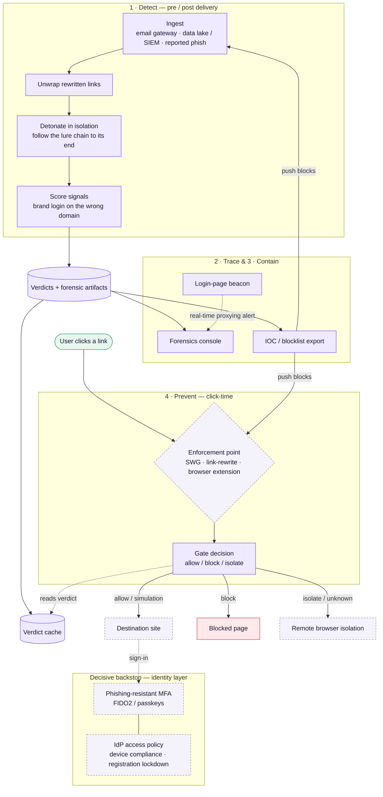

# Architecture

luretrace is four stages plus a backstop. Everything outside the dashed "luretrace" boundary is a
**role, not a product** — an enforcement point, an email gateway, a data lake, a remote browser,
an identity provider. Any vendor that fills the role works; swap them freely.

## The arc

1. **Detect** — links arrive from an email gateway, a data lake/SIEM, or a reported-phish mailbox.
   luretrace unwraps gateway rewrites, detonates each link in an isolated browser, follows the lure
   chain to its end, and scores it. The headline signal is a branded sign-in page on a domain the
   brand does not own. Verdicts and artifacts are written once; the verdict cache indexes them.
2. **Trace** — the forensics console reads those verdicts: a dashboard, a pass/fail scan list, and
   a full hop-by-hop forensics page for every failed link (redirects, credential-form flags,
   screenshots, downloads).
3. **Contain** — malicious verdicts export as IOCs and are pushed to the enforcement point and the
   email gateway to block the rest of the campaign. The login-page beacon raises a real-time alert,
   naming the attacker's domain, the moment your sign-in page is proxied.
4. **Prevent** — at click time the enforcement point asks the gate for a decision. The gate reads
   the cached verdict (it never detonates in the hot path): allow, block, or isolate. Unknown links
   fail safe to isolation; phishing-simulation clicks pass through untouched.

**Backstop (decisive).** None of the above replaces the identity layer. Phishing-resistant MFA
defeats the credential capture itself, and an IdP access policy requiring a compliant device —
with device-registration locked down — makes a stolen token useless and blocks the persistence
step. luretrace makes you faster and gives evidence; the identity controls are what make a click
survivable.

## Why tool-agnostic

Each box outside the engine is a role you already fill with something:

| Role in the diagram | Common fills (examples, not requirements) |
| --- | --- |
| Email gateway | Microsoft Safe Links, Mimecast, Proofpoint |
| Enforcement point | Secure web gateway, a link-rewrite service, a managed browser extension |
| Data lake / SIEM | Snowflake, Databricks, Azure Data Explorer, Elastic, Sentinel |
| Remote browser isolation | Your SWG's RBI, or a standalone RBI |
| Identity provider | Entra ID, Okta, Google Workspace |

luretrace talks to each over a documented seam (OAuth2 connectors, an IOC export, a `/check`
decision call), so no single vendor is load-bearing. See `docs/inline-agent.md` and
`docs/deployment.md`.
